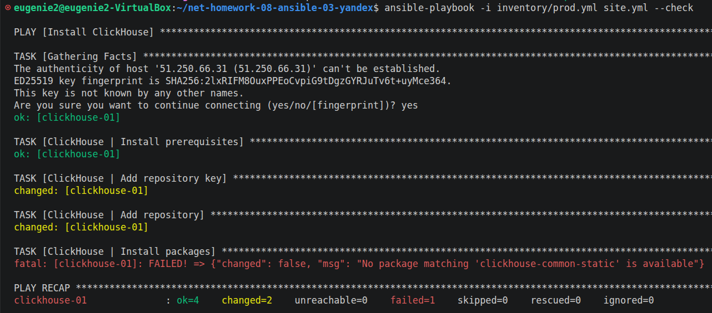
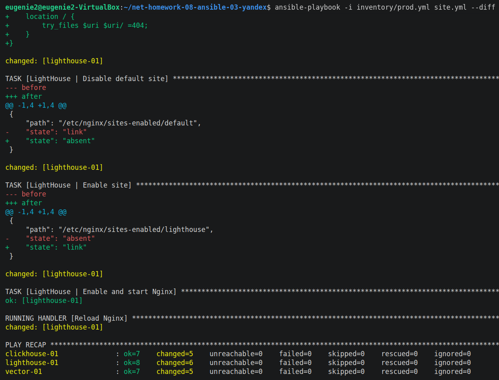
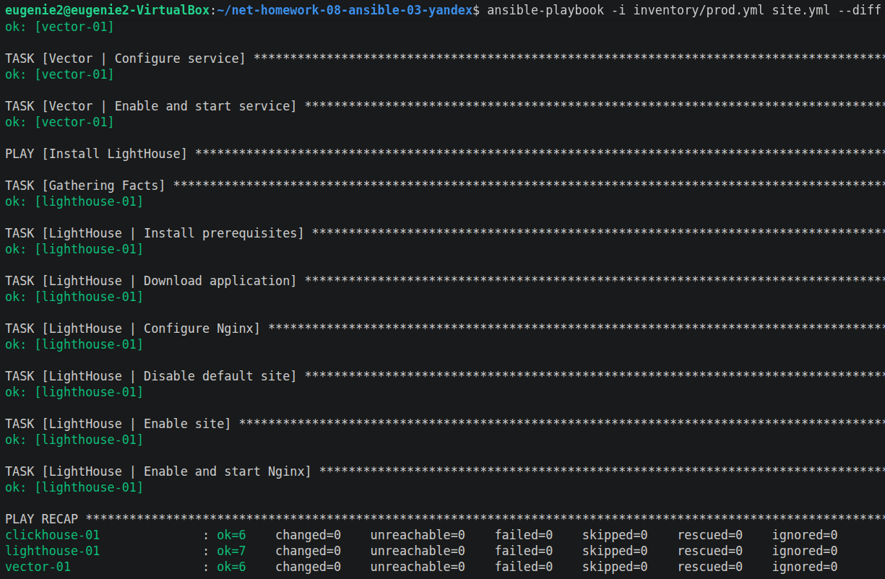
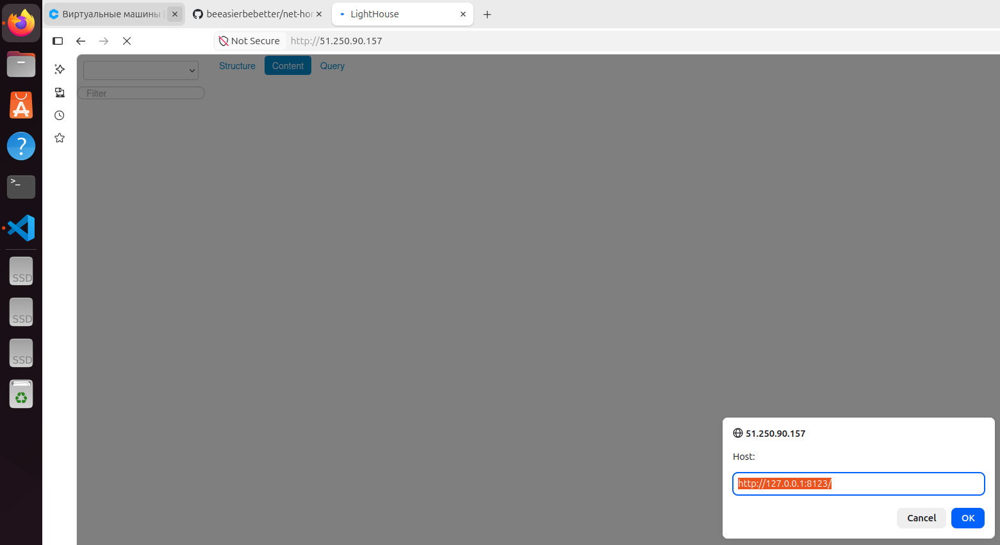

# Домашнее задание к занятию 3 «Использование Ansible» `Котуков Евгений`

## Подготовка к выполнению

1. Подготовьте в Yandex Cloud три хоста: для `clickhouse`, для `vector` и для `lighthouse`.
2. Репозиторий LightHouse находится [по ссылке](https://github.com/VKCOM/lighthouse).

## Основная часть

1. Допишите playbook: нужно сделать ещё один play, который устанавливает и настраивает LightHouse.
2. При создании tasks рекомендую использовать модули: `get_url`, `template`, `yum`, `apt`.
3. Tasks должны: скачать статику LightHouse, установить Nginx или любой другой веб-сервер, настроить его конфиг для открытия LightHouse, запустить веб-сервер.
4. Подготовьте свой inventory-файл `prod.yml`.
5. Запустите `ansible-lint site.yml` и исправьте ошибки, если они есть.
6. Попробуйте запустить playbook на этом окружении с флагом `--check`.
7. Запустите playbook на `prod.yml` окружении с флагом `--diff`. Убедитесь, что изменения на системе произведены.
8. Повторно запустите playbook с флагом `--diff` и убедитесь, что playbook идемпотентен.
9. Подготовьте README.md-файл по своему playbook. В нём должно быть описано: что делает playbook, какие у него есть параметры и теги.
10. Готовый playbook выложите в свой репозиторий, поставьте тег `08-ansible-03-yandex` на фиксирующий коммит, в ответ предоставьте ссылку на него.

---

### Как оформить решение задания

Выполненное домашнее задание пришлите в виде ссылки на .md-файл в вашем репозитории.

---

## Решение

Плейбук дописан, `inventory/prod.yml` подготовлен, линтер ошибок не выдал

Далее запустил с флагом `--check`, но выполнение упало на установке пакета, т.к. при этом флаге на предыдущем этапе пакет не скачался (ожидаемо):

Затем запустил плейбук с флагом `--diff` в первый раз:

Повторный прогон изменений не выдал, плейбук идемпотентен:

Результат выполнения:

### Описание плейбука

#### Окружение

- Ansible Core 2.16.3
- Ubuntu 24.04

#### Как работает плейбук

Плейбук содержит три play:

- ClickHouse: настраивает официальный apt репозиторий, устанавливает клиентский и серверный пакеты, добавляет в автозапуск и стартует сервис
- Vector: скачивает и устанавливает .deb-пакет, создает директорию для данных, устанавливает конфигурацию из темплейта и стартует сервис
- LightHouse: Ставит git и nginx, скачивает статику, настраивает достук через Nginx и стартует его

По умолчанию Vector пишет внутренние логи в консоль

#### Переменные

Переменные заданы в соответствующих group_vars. Для удобства таблица на английском:

| Parameter | Default | Description |
|---|---|---|
| clickhouse_version | 25.8.33.6 | ClickHouse package version |
| vector_version | 0.60.0 | Vector package version |
| vector_config | internal_logs -> console | Vector configuration |
| lighthouse_version | master | LightHouse branch, tag or commit |
| lighthouse_dir | /var/www/lighthouse | Application directory |
| lighthouse_port | 80 | Nginx listening port |

#### Тэги

| Tag | Scope |
|---|---|
| clickhouse | ClickHouse installation and service |
| vector | Vector installation, configuration and service |
| lighthouse | LightHouse and Nginx |
